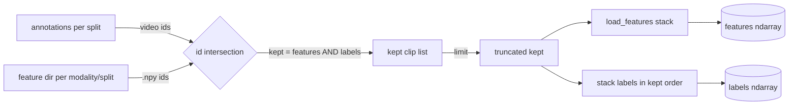

# Training Flow — `train_blstm.ipynb`

Reference document describing the BiLSTM training flow used in `train_blstm.ipynb`,
its sibling script `train_blstm.py`, and the artifacts consumed downstream by
`app_prediction/personality_detector.py`.

The notebooks trains **two independent** BiLSTM regressors, one per modality,
predicting the five Big-Five (OCEAN) traits in the range `[0, 1]`. There is **no
fusion layer at training time**; audio and visual scores are combined by late
fusion (element-wise average) during inference.

## Trait order

The five traits are fixed everywhere by `OCEAN`, index order matters because the
models emit logits in this order and `personality_detector.py` reads them back
with the same list:

| Index | Trait |
|---|---|
| 0 | extraversion |
| 1 | neuroticism |
| 2 | agreeableness |
| 3 | conscientiousness |
| 4 | openness |

## Per-modality configuration

| Modality | Feature source | Input shape `(seq, feat)` | Epochs | Params | Artifact |
|---|---|---|---|---|---|
| `audio` | VGGish embeddings | `(15, 128)` | 90 | 107,397 | `models/bilstm_audio_tf.keras` |
| `visual` | VGG-Face embeddings | `(30, 4096)` | 55 | 2,139,013 | `models/bilstm_visual_tf.keras` |

---

## 1. System position

```mermaid
flowchart TD
    subgraph up[Upstream feature extraction]
        V[raw videos] -->|vid_to_vec.ipynb / vid_to_wav_vec.ipynb| A[audio (15,128)]
        V --> B[visual (30,4096)]
    end
    subgraph tr[Training train_blstm.ipynb]
        A --> N{z-score<br/>train-only stats}
        B --> N
        N --> M[BiLSTM x2]
        M -->|history.json + norm_stats.json| AR[models/*.keras]
        M -->|history.json| HR[models/*_history.json]
        N --> SR[app_prediction/models/norm_stats_*.json]
    end
    subgraph dn[Downstream inference personality_detector.py]
        AR -->|load| P
        SR -->|load| P[PersonalityPredictor]
        V2[videos] -->|extract| A2[audio feature]
        V2 --> B2[visual feature]
        P --> S1[audio OCEAN score]
        P --> S2[visual OCEAN score]
        S1 --> F[(fuse = mean)]
        S2 --> F
        F --> R[(fused OCEAN)]
    end
    classDef box fill:#f5f7fa,stroke:#b8c1d1;
    class AR,HR,SR box
```

The training notebook consumes already-extracted features in
`output/{audio,visual}/{train,val,test}/*.npy` and ChaLearn annotations in
`first-impressions/annotations/`. It writes the three objects the inference
module depends on: the trained Keras model, a normalization JSON per modality,
and a `history.json` describing the training configuration and metrics.

---

## 2. Dataset and label construction

Annotations come from the ChaLearn First Impressions release, read as a Python
pickle whose top-level structure is `{trait: {clip_id: score}}`.

```
load_labels(annotations_dir, split)
```

1. **Container selection.** `train` reads `train-annotation/annotation_training.pkl`
   (a plain pickle file). `val` and `test` read `val-annotation/annotation_validation.pkl`
   and `test-annotation/annotation_test.pkl`, respectively. Each container is a
   pickle; no zip extraction happens from memory in the notebook cell.
2. **Flatten.** For every `trait` in `OCEAN`, each `clip:score` pair is
   collected into `mapping[stem][trait] = float(score)`. A trailing `.mp4`
   extension, if present on the clip key, is stripped to form the `stem`.
3. **All-five filter.** Only stems that carry **all five** traits survive, and
   their value is stored as a `float32` array of length 5 ordered by `OCEAN`.

The result is `{video_id: float32(5,)}`. Only clips present in **both** the
label map and the extracted feature directory become training/eval samples (see
Section 4). For audio/visual the surviving set is **5962 train** clips and
**1987** validation clips. The notebook `config` supports an optional third
split (`eval_test=True`) that additionally scores the test set, but the default
run is train + validation only.

---

## 3. Input tensor specification

Each sample is a single clip represented by a fixed-shape embedding sequence:

| Modality | File layout | Shape | dtype | Source |
|---|---|---|---|---|
| audio | `output/audio/<split>/<id>.npy` | `(15, 128)` | float32 | VGGish |
| visual | `output/visual/<split>/<id>.npy` | `(30, 4096)` | float32 | VGG-Face |

The notebook expects one file per clip, named `<clip_id>.npy`. Three
**silent rejection rules** are applied per file before it is admitted to the
dataset:

- `np.load` raising `OSError` or `ValueError` (corrupt or truncated array);
- `arr.shape != (seq_len, feat_dim)` (wrong length/feature count);
- `np.isfinite(arr).all()` is `False` (NaN or Inf anywhere in the tensor).

Rejected clips are dropped without a warning; only the surviving count is
printed. Because some clips can be silently dropped, the label tensors are
re-stacked from the returned `kept` list (the authoritative surviving clip
order) and **not** from the originally requested clip list — this is what
keeps features and labels aligned after filtering.

---

## 4. Data alignment and clip intersection



The surviving clips are the intersection of (a) feature files present on disk
for that modality/split, and (b) label ids from the pickle. The list is then
optionally truncated by `limit` (for smoke runs) and passed to `load_features`,
which returns both the stacked array and the `kept` ids.

---

## 5. Preprocessing methodology

### 5.1 Z-score normalization (train-only statistics)

Features are standardized **per feature dimension**, with statistics computed
**from the training split only**:

```
mean = mean_{clip, time}(X_train)        shape (feat_dim,)
std  = std_{clip, time}(X_train) + 1e-8   shape (feat_dim,)
X_norm = (X - mean) / std
```

The reduction is over axes `(0, 1)` (clips and time steps), yielding one scalar
mean and std per input feature. The `+1e-8` epsilon guards division by zero. The
train-derived `mean`/`std` are applied **in place** to train and validation
arrays (and to the test array, when `eval_test=True`), which is what prevents
test-set statistics from leaking into training.

The same two arrays are serialized to
`app_prediction/models/norm_stats_{audio,visual}.json` so that
`personality_detector.py` can apply the **identical** transformation to live
features. The inference module is also capable of recomputing these statistics
from the training features via `compute_norm_stats` if a JSON is missing.

### 5.2 Storage dtype selection

The full feature matrices can be large; for the visual modality with 5962 train
clips of shape `(30, 4096)` as float32 the training set alone is ≈ 2.9 GB.
`pick_dtype` reads `/proc/meminfo` and, when `dtype == "auto"`, chooses:

```
need32 = total_clips * seq_len * feat_dim * 4 + 1.5e9   # float32 + TF reserve
float32 if need32 <= 1.3 * MemAvailable, else float16
```

When float16 storage is chosen, the `Sequence` casts each batch to float32
before it reaches Keras, so training still runs in float32 while peak host
memory stays lower.

---

## 6. Model architecture

For either modality the network is identical in structure:

```mermaid
flowchart LR
    I([Input seq feat]) --> B[Bidirectional LSTM 64\n(returns 128)]
    B --> D1[Dropout 0.3]
    D1 --> H[Dense 64 relu]
    H --> D2[Dropout 0.3]
    D2 --> O([Dense 5 sigmoid])
```

- `Input(seq_len, feat_dim)`.
- `Bidirectional(LSTM(64))` — forward plus backward pass, concatenation yields
  `2 * 64 = 128` units. The LSTM parameter count per direction is
  `4 * hidden * (feat + hidden + 1)` (input, forget, output, cell gates), so
  both directions double it.
- `Dropout(0.3)` × 2 (after the recurrent block and after the hidden dense).
- `Dense(64, relu)` bottleneck.
- `Dense(5, sigmoid)` head named `ocean_output`, squashing each trait into
  `[0, 1]`.

Compile: `Adam(learning_rate=1e-4, weight_decay=1e-5)`, `loss = "mse"`,
`metrics = ["mae"]`. MSE fits the bounded regression setting (sigmoid output
already saturates into `[0, 1]`, so the loss is a plain squared distance per
trait); MAE is the monitored metric both for early stopping and for reporting.

| Modality | LSTM params | Dense(64) | Head | Total |
|---|---|---|---|---|
| audio (128) | 98,816 | 8,256 | 325 | 107,397 |
| visual (4096) | 2,130,432 | 8,256 | 325 | 2,139,013 |

The visual model is dominated by the `4096 -> 128` recurrent input projection;
capacity therefore comes from the embedding width, not the recurrence.

---

## 7. Training procedure

```mermaid
flowchart TD
    A[select modality] --> B[load_labels train/val]
    B --> C[intersect with feature files]
    C --> D[pick_dtype RAM-aware]
    D --> E[load_features float16/32]
    E --> F[compute train mean/std]
    F --> G[apply z-score in place]
    G --> H[save norm_stats_{mod}.json]
    H --> I[build_model compile]
    I --> J[fit Sequence\nEarlyStopping val_mae]
    J --> K[restore best weights]
    K --> L[predict val metrics]
    L --> M[save bilstm_{mod}.keras]
    M --> N[save history.json]
    N --> O{eval_test?}
    O -->|yes| P[load test, normalize, predict]
    O -->|no| Q[clear session]
    P --> Q
    Q --> R[next modality]
```

Step-by-step, per modality:

1. **Label load** for `train` and `val` (plus `test` if `eval_test`).
2. **Clip intersection** with `feature_clips` and optional `limit` truncation.
3. **Dtype selection** (`pick_dtype`) to bound peak memory.
4. **Feature load** into a preallocated array filled file-by-file.
5. **Train-only statistics** computed and persisted (Section 5).
6. **Model build** via `build_model`, `compile` with Adam/MSE/MAE.
7. **`model.fit`** over a `keras.utils.Sequence` with
   `EarlyStopping(monitor="val_mae", patience=10, restore_best_weights=True)`.
   The sequence owns a permutation of indices, reshuffled per epoch for the
   train splitter only.
8. **Validation** `predict` with the restored best weights (so reported metrics
   come from the checkpoint that will actually be saved, not the final epoch).
9. **Artifact write**: `bilstm_{mod}_tf.keras` and
   `bilstm_{mod}_tf_history.json` (config, counts, best epoch, val metrics, and
   the full per-epoch `loss`/`mae`/`val_loss`/`val_mae` history).
10. The same z-score transform is applied to the test array and the test set
    scored, only when `eval_test=True`.
11. Between modalities the train/val arrays and the Keras session are released
    (`del`, `clear_session()`, `gc.collect()`) because the visual float32 set is
    large (~3.9 GB for train + validation together).

Defaults train both modalities for the proven schedule: audio 90 epochs, visual
55, with the early-stopping patience of 10 cutting them short (audio stopped at
epoch 82, best epoch 72; visual at epoch 55, best epoch 52). Batch size is 32
throughout; `hidden = 64`; `dropout = 0.3`; `lr = 1e-4`; `weight_decay = 1e-5`.

### TF runtime setup

`prepare_tf()` configures TensorFlow exactly once and threads the handle
through every helper:

- `TF_CPP_MIN_LOG_LEVEL = 2` to suppress C++ info logging.
- `set_memory_growth(True)` on every visible GPU.
- Mixed precision policy `mixed_float16` when a GPU is present, else `float32`.
- `tf.keras.utils.set_random_seed(42)` together with `random.seed` and
  `np.random.seed`; the `Sequence` shuffles with its own
  `np.random.default_rng(42)`.

---

## 8. Evaluation methodology

Metrics are computed by `regression_metrics(y_true, y_pred)`, casting both
arrays to float64:

- Per-trait MAE and RMSE are column-wise (one value per trait).
- Per-trait R² is the standard coefficient of determination per trait,
  `R² = 1 - SS_res / SS_tot`, with `SS_tot` reduced to `0.0` if a trait is
  constant in the ground truth.
- **`overall.mae`** is the mean of the five per-trait MAEs.
- **`overall.rmse`** is `sqrt(mean(err²))` pooled over **all** elements
  (not the mean of per-trait RMSE).
- **`overall.r2`** is the mean of the five per-trait R² values — **not** a
  pooled R². It should be read as "average trait-level explanatory power" and
  is slightly lower than a single pooled R² would be.

Headline numbers are written into `models/bilstm_{mod}_tf_history.json` under
`val_metrics`, computed from the restored best weights. The best epoch itself
is the epoch index of the minimum recorded `val_mae` in the training history.

---

## 9. Artifacts produced

| Path | Content |
|---|---|
| `models/bilstm_{mod}_tf.keras` | SavedModel-format Keras model, loadable by `tf.keras.models.load_model`. |
| `models/bilstm_{mod}_tf_history.json` | `modality`, `traits`, `config`, `data` (train/val/test clip counts and `features_root`), `norm_stats` path, `best_epoch`, `best_val_mae`, `val_metrics`, optional `test_metrics`, full per-epoch `history`. |
| `app_prediction/models/norm_stats_{mod}.json` | `{"mean": [...], "std": [...]}`, one scalar per feature dimension. |

Downstream the inference module consumes only:

```
models/bilstm_audio_tf.keras
models/bilstm_visual_tf.keras
app_prediction/models/norm_stats_audio.json
app_prediction/models/norm_stats_visual.json
```

and combines the two modality scores by arithmetic mean.

---

## 10. Reproducibility notes

- `SEED = 42` is applied to `tf.keras.utils.set_random_seed`, `random`, and
  `np.random.seed`, and the data `Sequence` shuffles with its own
  `np.random.default_rng(42)`.
- Exact bitwise parity across machines is **not** guaranteed: cuDNN/cuBLAS
  reduction order and the `mixed_float16` policy introduce non-determinism, as
  do the oneDNN round-off differences logged at startup. Expect metric drift on
  the order of ~1e-3 between machines/builds, while same-machine reruns stay
  reproducible to ~1e-6.
- Per-epoch `loss`, `mae`, `val_loss`, `val_mae` are stored in the
  `*_history.json` under `history`, so a run can be replayed for plotting
  without retraining.

---

## 11. Methodological limitations

- **Independent modality models.** Audio and visual BiLSTMs are trained
  separately; cross-modal correlation is exploited only at inference via late
  averaging, never during representation learning. Joint training (e.g., a
  shared or co-trained fusion head) is not explored here.
- **Modest predictive ceiling.** Validation R² lands at ~0.30 (audio) and
  ~0.37 (visual) under this split; the models explain roughly a third of trait
  variance, which is consistent with first-impressions regression from
  pretrained embeddings. Any downstream "personality score" inherits this
  ceiling and should not be over-interpreted.
- **Silent clip dropping.** Clips rejected by the shape/finite/NaN rules (or
  absent from one modality) are skipped without a warning; a drop in the
  printed clip count is a diagnostic signal that feature extraction is
  suspect, not a data-pipeline guarantee.
- **Train/validation split only by default.** The default run scores a single
  validation split, so `val_metrics` carry the variance of one partition rather
  than a cross-validated estimate; `eval_test=True` adds a test pass but still
  no cross-validation.
- **float16 storage trade-off.** If RAM forces `dtype="float16"`, the
  in-place normalization runs in float16, introducing ~1e-3 relative error in
  the standardized inputs; this is acceptable for training but breaks exact
  parity with a float32 run.
